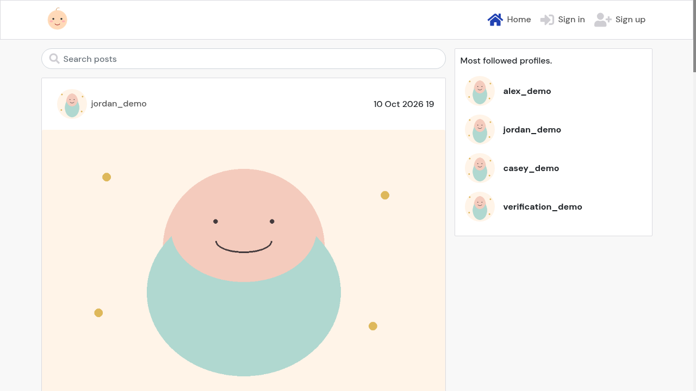
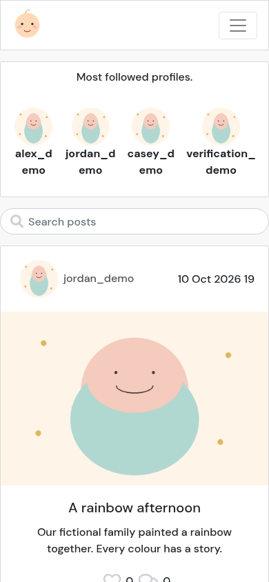

# Baby Daily

**Português (Brasil)** | [English](README.md) | [Licença MIT](LICENSE)

> Sorrisos, passos e histórias. Todos os dias! Um pequeno app social onde pais compartilham os marcos do bebê com família e amigos. Criado em 2023 como projeto final do Code Institute e trazido de volta à vida em outubro de 2026.

## Demo

Use o selo acima para abrir no navegador. Sem instalação, sem terminal.

A demo roda em hospedagem gratuita e usa apenas dados fictícios. As fotos e avatares são imagens geradas por IA de famílias imaginárias. A instância gratuita da API dorme quando fica parada, então a primeira requisição pode levar 50 segundos ou mais. Não envie fotos reais de crianças nem informações pessoais.

Capturas históricas de 10/10/2026, feitas antes de o seed da demo ser trocado pelas fotos de famílias geradas por IA (só dados fictícios). A demo ao vivo mostra o conteúdo atual.

## A história

1. **Ideia (2023).** Um feed de círculo de confiança para pais de primeira viagem: posts com fotos, comentários, curtidas, seguidores, lista de tarefas de marcos e lista de desejos. Planejado com 21 histórias de usuário num quadro do GitHub.
2. **Primeira versão (ago-dez 2023).** API Django REST Framework com front-end React, hospedada no Heroku. O histórico completo de commits está neste repositório.
3. **Hospedagem perdida.** Em 2026 a hospedagem original de 2023 (app no Heroku e seu banco) não estava mais ativa, então o app estava fora do ar. Este README não afirma uma causa específica.
4. **Revival (out 2026).** Django 5.2 LTS, build com Vite, gateway `/api/` na mesma origem no Cloudflare Pages, Render Free para a API, Neon Free para o PostgreSQL, Cloudinary para mídia. Segredos e dados pessoais históricos foram removidos antes da publicação. Os dados da demo são fictícios.
5. **Passada de qualidade.** Correções de acessibilidade (rótulos, áreas de toque, contraste, mensagens de validação), horários completos, verificações de deploy no CI e uma revisão final antes de tornar público.

## Arquitetura

- Django 5.2 LTS e Django REST Framework, PostgreSQL em produção (SQLite local).
- React 17, React Router 5, Vite com Node 22.
- Front-end no Cloudflare Pages com gateway `/api/` na mesma origem para a API no Render.
- Cookies JWT HttpOnly, checagem CSRF, hosts e origens explícitos, `DEBUG` desligado em produção.
- Segredos ficam nos painéis de hospedagem e não são versionados. `.env.example` lista só nomes de variáveis.

## Segurança e privacidade

- Contas e conteúdo da demo vêm de `python manage.py seed_demo`: três perfis fictícios, cinco histórias com comentários e curtidas, uma tarefa e um desejo. As contas do seed não têm senha utilizável. O cadastro não pede e-mail.
- `bash scripts/check-deploy.sh` roda as checagens de produção do Django antes de cada deploy. O CI roda o mesmo caminho com credenciais descartáveis. O único aviso esperado é `security.W004` (HSTS), mantido desligado de propósito até a revisão de um rollout com domínio próprio.
- Dependências verificadas (`npm audit`, `pip-audit`): zero vulnerabilidades conhecidas em 11/10/2026.
- O modelo de permissões original permite leitura anônima dos posts. Para uma demo fictícia isso serve; para famílias reais exigiria checagem de círculo de confiança (veja a issue #2).
- Antes de tornar público, os patches das quatro branches e 26 issues e pull requests foram varridos em 12/10/2026 em busca de dados pessoais, chaves e tokens. Nada foi encontrado. É uma revisão por padrões, não uma garantia. Hostnames mortos de Gitpod e Heroku permanecem no histórico antigo.
- Os screenshots de 2023 que usavam arte de terceiros foram removidos da versão atual. O histórico de commits de 2023 foi preservado como estava, incluindo esses arquivos: na época do curso, direitos autorais de imagens não eram o foco. Se você é titular de algum material e quer a remoção, abra uma issue.

## Testes

- Backend: `python manage.py test` (16 testes: CRUD e propriedade de posts, login JWT, cadastro, health).
- Frontend: `cd frontend && npm test` (13 testes Vitest + MSW de navegação, autenticação e acessibilidade).
- Build: `cd frontend && npm run build`.
- Verificações ao vivo em 10/10/2026: cadastro, login, cookies Secure/HttpOnly, criar/editar/apagar posts, tarefas e desejos, refresh de token, logout.

## Rodar localmente

Python 3.12 e Node 22. Crie um ambiente virtual, `pip install -r requirements.txt`, defina um `SECRET_KEY` gerado e `DEV=1`, rode `python manage.py migrate` e `python manage.py seed_demo`, depois `python manage.py runserver 8000`. Em `frontend/` rode `npm ci` e `npm start`.

## Roadmap

- Permissões de círculo de confiança: convites por pessoa, ver/postar/reagir sem apagar (issue #2).
- Controle de acesso à mídia e marca d'água do visualizador.
- Sair da hospedagem gratuita se o app algum dia for usado por famílias reais.

## Como foi construído

Planejado e decidido por Iuri Johansson. A Instinct executa o que ele decide: auditorias, correções, passadas de QA e documentação, com cada mudança em pull request.

## Créditos e licença

Baseado nos tutoriais Django REST Framework e Moments do Code Institute; seus créditos e termos de terceiros estão no registro histórico abaixo. Código e ilustrações originais de Iuri Johansson, sob a [licença MIT](LICENSE).

---
O registro histórico completo de 2023 (histórias de usuário, esquema do banco, testes manuais) está na [versão em inglês](README.md#historical-project-record-2023).
